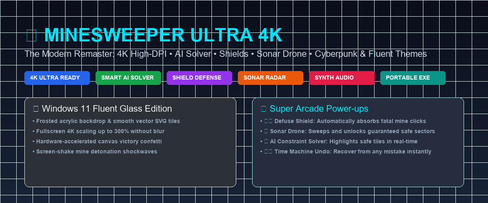
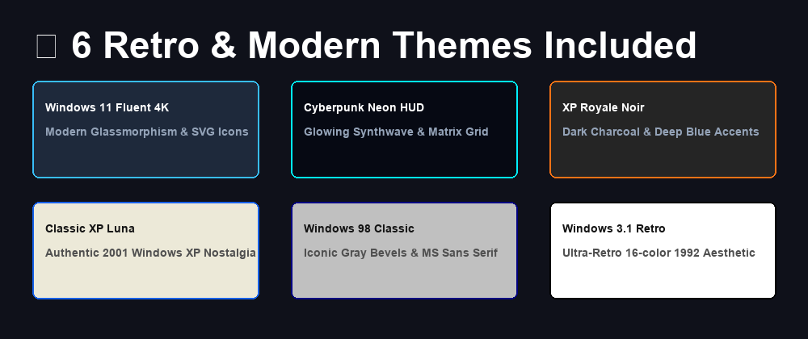

<div align="center">

# 💣 Minesweeper Ultra 4K (Enhanced Edition)

**The Ultimate Modern Remaster of Classic Minesweeper for Windows 11 & 10.**
*Featuring 4K High-DPI Vector Graphics, Smart AI Solver, Defuse Shields, Sonar Drone, Canvas Confetti & 6 Themes.*

[](https://github.com/dor2500/minesweeper-ultra-4k/releases)
[](https://github.com/dor2500/minesweeper-ultra-4k)
[](https://golang.org)
[](https://react.dev)
[](https://github.com/dor2500/minesweeper-ultra-4k)
[](LICENSE)

<br/>



</div>

---

## 🌟 What makes Minesweeper Ultra 4K special?

Most Minesweeper clones are either low-resolution 90s ports that look tiny and blurry on modern 2K/4K monitors, or slow ad-filled web games. 

**Minesweeper Ultra 4K** solves this by combining the **authentic retro feel** with modern **4K vector graphics, hardware-accelerated particle effects, synthesized retro audio**, and **Arcade power-ups** that make playing infinitely more fun and fair!

---

## 🚀 Key Features & Enhancements

### 💎 Modern 4K High-DPI Vector Graphics
* **Crisp at Any Scale:** Full SVG vector rendering for tiles, flags, mines, and numbers when playing in modern modes. Never blurry or pixelated on 4K/2K screens!
* **High-DPI Zoom Controls:** 100%, 150%, 200%, 250% scales, plus **⛶ Fullscreen Mode (F11)**.

### 🧠 Smart AI Solver (Press `H`)
* Built-in constraint solver engine calculates 100% deterministic moves:
  * 🟢 **Green Pulse:** 100% Guaranteed Safe Tile
  * 🔴 **Red Pulse:** 100% Confirmed Mine
  * 🟡 **Yellow Pulse:** Safest statistical move when a 50/50 guess is forced.

### 🛡️ Defuse Shield (Arcade Mode)
* Accidental click on a mine? The shield automatically deflects the explosion, triggers an electric blue shockwave, flags the mine, and saves your game! (2 charges per game).

### 📡 Sonar Drone Scan (Press `D`)
* Launches a radar sweep drone that reveals and opens safe sectors on the board without risking a detonation.

### ↩️ Time Machine Undo (`Ctrl + Z`)
* Step back moves at any time. If you run out of shields and detonate a mine, press `Ctrl + Z` to resurrect and continue your streak!

### 🎯 Guaranteed Safe 1st Click (Cascade Opening)
* Never open an isolated number on your first move again! The board algorithm guarantees an opening zero cascade.

### 🔊 100% Offline Synthesized Audio (Web Audio API)
* Zero external audio files required! Synthesizes clicks, flag taps, question mark blips, sub-bass explosions, second ticks, and majestic triumphant fanfares natively with sub-millisecond latency.

### 🎨 6 Hand-Crafted Themes

1. **💎 Windows 11 Fluent 4K:** Frosted glass acrylic window, smooth shadows, and modern vector icons.
2. **⚡ Cyberpunk Neon HUD:** Synthwave neon cyan and magenta grid with glowing borders.
3. **🌙 XP Royale Noir:** Elegant dark charcoal aesthetic with deep blue highlights.
4. **Classic XP Luna Blue:** Authentic, pixel-perfect 2001 Windows XP nostalgia.
5. **Windows 98 Classic:** Iconic gray bevels and 90s system fonts.
6. **Windows 3.1 Retro:** High-contrast 1992 retro style.

### 📐 Dynamic Custom Fields
* Create boards of any size: Width (8–36), Height (8–30), and custom mine density. The window smoothly expands to fit the custom dimensions.

### 🏆 Fastest Times & Win Streaks
* Automatically tracks your personal best times, win percentage, and current win streaks with local storage persistence.

---

## ⌨️ Keyboard Shortcuts Cheat Sheet

| Key | Action |
| :--- | :--- |
| **`F2`** | 🔄 New Game |
| **`F11`** | ⛶ Toggle 4K Fullscreen Mode |
| **`H`** | 💡 Trigger Smart AI Hint |
| **`D`** | 📡 Deploy Sonar Drone Scan |
| **`X`** | ⚡ Toggle X-Ray Mine Radar |
| **`Ctrl + Z`** | 🛡️ Undo Move / Revive from Explosion |
| **`S`** | 🔊 Toggle Sound Effects |
| **Right Click** | 🚩 Flag / Question Mark / Unflag |
| **Double Click / Middle Click** | ⚡ Quick Chord (reveal adjacent tiles) |

---

## 📦 Download & Run

No installation required! Simply download the standalone portable executable:

➡️ **[Download Minesweeper XP Ultra 4K.exe](https://github.com/dor2500/minesweeper-ultra-4k/releases)**

---

## 🛠️ Building from Source

### Prerequisites
* [Go](https://go.dev/) 1.22+
* [Node.js](https://nodejs.org/) 18+ and npm
* [Wails v2](https://wails.io/) CLI (optional; standard `go build` works out of the box!)

### Build Instructions
```bash
# 1. Clone the repository
git clone https://github.com/dor2500/minesweeper-ultra-4k.git
cd minesweeper-ultra-4k

# 2. Build the React frontend
cd frontend
npm install
npm run build
cd ..

# 3. Compile the standalone Windows executable
go build -ldflags "-H windowsgui -s -w" -o "Minesweeper XP Ultra 4K.exe"
```

---

## 🤝 Credits & Acknowledgements
* Based upon the original open-source [Minesweeper-XP](https://github.com/AkshayKalose/Minesweeper-XP) by **Akshay Kalose**.
* Enhanced and remastered with 4K vector graphics, AI solver, arcade power-ups, particle physics, and sound synthesis by **Dor P**.

---

## 📄 License
This project is open source and available under the [MIT License](LICENSE).
